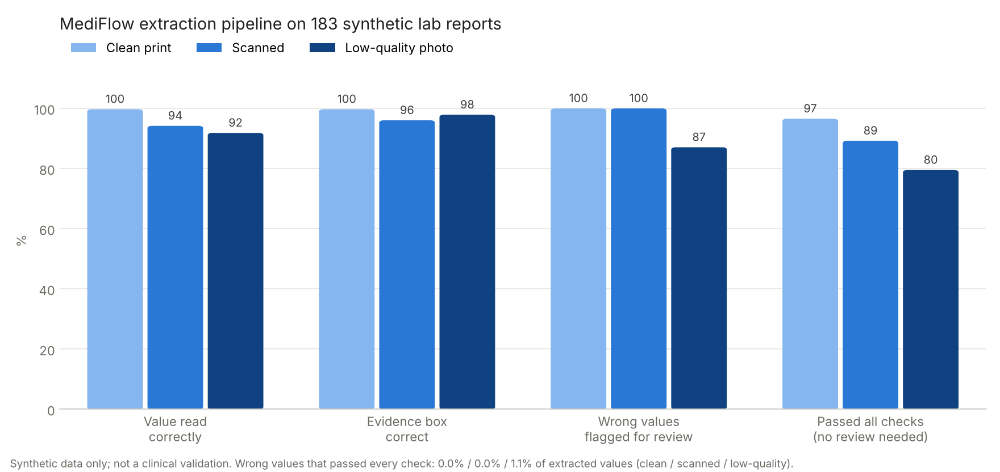

# MediFlow: evidence-linked patient case-taking (research prototype)
Live Link :- MediFlow prototype · Streamlit https://share.google/P8rssJDkuiOtz0JI6
Final-year capstone, B.Tech CSE (AI/ML), Lovely Professional University.
Inspired by SIH26047 *Patient Case-Taking Software*.

> **Synthetic data only. Not a medical device. Not for clinical use.**
> MediFlow does not diagnose, prescribe or recommend treatment. Everything it
> produces stays a draft until a clinician reviews it.

## What this prototype does (working today)

One narrow end-to-end slice of the proposed system:

1. **Guided intake** in English, Hindi or Telugu. Closed answers are stored as
   language-independent codes. Free text is stored exactly as typed, with no machine
   translation. *The Hindi/Telugu wording is a draft and still needs validation.*
2. **Printed lab-report processing.** Tesseract OCR with word positions, automatic
   deskew, and extraction of test, value, unit, reference range, printed flag and report date.
3. **Evidence links.** Every extracted value stores the pixel box it was read from,
   so the doctor can see that exact spot on the original page.
4. **Independent checks before anything is trusted:** OCR confidence, a second
   independent read of the evidence region, a technical plausibility range
   (catches lost decimal points), unit check, and date check. Any failed check means
   `needs_review`. The system never silently "fixes" a value.
5. **Three provenance tiers:** patient-reported, machine-extracted and
   clinician-confirmed, shown separately and never merged.
6. **Conflict handling.** Two documents giving different values for the same test on
   the same date are both kept, shown side by side, and flagged for the clinician.
7. **Doctor review.** Accept, edit (the original machine value is kept) or reject,
   with an audit log.
8. **Longitudinal timeline and draft summary.** The summary is template-based, so every
   sentence comes from specific record items and links to them. It cannot add facts.

## Results (synthetic lab reports)

183 report images (61 reports × 3 quality levels) from 20 synthetic patients,
1,143 ground-truth fields. Reproduce with `python ai-engine/scripts/run_pipeline.py`.

| Metric | Clean print | Scanned | Low-quality photo |
|---|---|---|---|
| Character error rate (full page) | 1.4% | 2.3% | 3.5% |
| Test detection F1 | 99.9% | 100% | 100% |
| Value read exactly right | 99.7% | 94.2% | 91.9% |
| Unit correct | 99.7% | 95.0% | 92.9% |
| Report date correct | 100% | 100% | 90.2% |
| **Evidence box correct** (IoU ≥ 0.5) | 99.7% | 96.1% | 97.9% |
| **Wrong values caught by checks** | 100% (1/1) | 100% (22/22) | 87.1% (27/31) |
| Correct values flagged anyway (false alarms) | 3.2% | 5.3% | 14.6% |
| **Wrong AND passed every check** (silent errors) | 0% | 0% | 1.1% |



**Main finding so far.** The checks catch every misread on clean and scanned
pages. On low-quality photos 4 wrong values got through (for example 0.69 read as
6.69). The second read uses the same OCR engine, so on blurry images both reads
make the *same* mistake. Next experiment: use a different OCR engine as the second
reader (e.g. PaddleOCR or docTR) and measure whether silent errors drop.

**Read these numbers honestly.** The documents come from our own generator, with
three layouts that the extractor was developed against. Real lab reports have many
more layouts, so real-world accuracy will be lower. These results show the pipeline
works and the method of measuring it. They are not evidence of clinical accuracy.

## Run it

1. Install Tesseract OCR
   - Windows: the UB Mannheim installer (https://github.com/UB-Mannheim/tesseract/wiki),
     then `set TESSERACT_CMD=C:\Program Files\Tesseract-OCR\tesseract.exe`
   - Ubuntu: `sudo apt install tesseract-ocr`
   - macOS: `brew install tesseract`
2. Python packages
   ```bash
   python -m venv .venv && .venv\Scripts\activate      # Windows (source .venv/bin/activate on Linux/macOS)
   pip install -r requirements.txt
   ```
3. Generate data and evaluate (about 4 minutes)
   ```bash
   cd ai-engine
   python scripts/run_pipeline.py --patients 20
   python scripts/plot_results.py
   cd ..
   ```
4. Start the demo
   ```bash
   streamlit run demo/app.py
   ```
5. Tests: `python -m pytest tests -q`

## 5-minute demo script for a review meeting

1. **Intake:** switch to Telugu or Hindi, answer the questions, submit. Point out that
   answers are stored as codes and marked *patient-reported*.
2. **Upload:** pick a patient marked *(has a same-day report from another lab)*,
   choose **Low-quality phone photo**, and load.
3. **Doctor review:** turn on *Show only items that need review*. Open one item and show
   the evidence crop, both OCR reads and the reason it was flagged. Edit or accept it.
4. **Timeline:** show the conflict panel (both values kept, nothing auto-resolved) and
   open a summary line to see its source crops.
5. **Evaluation:** show the table, then explain the silent-error finding and the next experiment.

## Repository layout

```
MediFlow/
├── ai-engine/mediflow/     # core pipeline (Python)
│   ├── catalog.py          # supported tests, units, plausibility ranges
│   ├── synth.py            # synthetic lab-report generator + ground truth with boxes
│   ├── ocr.py              # Tesseract word boxes, deskew, second-read
│   ├── extract.py          # evidence-linked extraction + verification checks
│   ├── record.py           # provenance tiers, conflicts, timeline, draft summary, audit
│   ├── intake.py           # guided questions (en / hi / te)
│   └── evaluate.py         # metrics
├── ai-engine/scripts/      # run_pipeline.py, plot_results.py
├── demo/app.py             # Streamlit prototype UI
├── datasets/synthetic/     # generated images + ground-truth JSON
├── results/                # metrics.json, per_document.json, metrics_chart.png
├── documentation/screenshots/
├── frontend/  backend/     # planned React + Django REST (not started)
└── tests/
```

## Not done yet (honest scope)

- No real patient data, clinical expert validation, or user study.
- Only printed lab reports with three synthetic layouts. No prescriptions, discharge
  summaries or handwriting.
- No LLM. Extraction is rule-based and the summary is template-based on purpose,
  so there is a no-hallucination baseline to compare an LLM against later.
- Hindi/Telugu question wording is unvalidated. No voice input.
- No authentication, encryption, ABDM or FHIR. The React/Django app is not built.
  The Streamlit demo is a prototype UI only.

## Planned next experiments

1. A second reader from a different OCR engine, to cut silent errors on poor photos.
2. Hard negatives: unseen report layouts, two-column reports, multi-page reports.
3. An LLM extractor that must return evidence spans, compared with this rule-based baseline
   on accuracy and silent-error rate.
4. With clinician participants (after approval): verification time and errors caught
   with vs without evidence links (RQ2).
